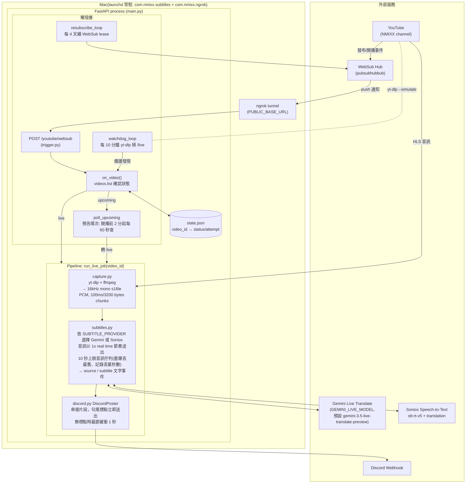

# 架構設計

單一 Python process（FastAPI），跑在 Mac 上由 launchd 常駐，一次只處理一場直播。
整體分三層：**觸發層**（發現直播）、**Pipeline**（音訊 → 字幕）、**狀態與韌性**（重試與重開機恢復）。



## 觸發層（怎麼知道開播了）

主要靠 **WebSub push**：啟動時向 hub 訂閱頻道（lease 5 天，`resubscribe_loop` 每 4 天續約），
YouTube 有新影片/開播就 push 到 `POST /youtube/websub`（經 ngrok 進來）。收到後 `on_video()`
用 YouTube Data API `videos.list` 確認真實狀態：

- `live` → 直接開 job
- `upcoming` → `poll_upcoming`：排定開播前 2 分鐘開始每 60 秒查一次，2 小時沒開播就放棄
- 其他（已結束/非直播）→ 記錄後忽略

備援是 **watchdog**：每 10 分鐘用 `yt-dlp --simulate` 掃頻道 `/live` 頁，接住 WebSub 漏掉的場次。

## Pipeline（run_live_job，直播期間持續執行）

```
yt-dlp + ffmpeg → 100ms PCM chunks(16kHz mono s16le，以 1x real time 節奏送出)
→ subtitles.py 選擇單一供應商（預設 gemini）
  Gemini: live_translate.py → output_audio_transcription(zh-Hant 增量翻譯片段)
  Soniox: soniox_translate.py → final tokens（中文譯文／英文原文）→ OpenCC 繁體轉換
→ DiscordPoster 串接片段(句尾標點立即送，無標點時 1s fallback) → webhook
```

兩個供應商都沒有本機 ASR，也沒有另外一次文字翻譯 call。每場只使用一個供應商，
不會遇錯誤就自動切換到另一個付費服務；改 `.env` 後需重新啟動。

### Soniox

`SONIOX_MODEL` 預設 `stt-rt-v5`，同一條 WebSocket 回傳原文與翻譯文字，不產生翻譯語音。
預設 `SONIOX_TRANSLATE_ENGLISH=false` 使用官方支援的 `two_way` 韓中配對：韓文翻中文，
英文及配對以外語言只轉錄並原樣顯示。中文原文也會顯示；API 產生的反向韓文譯文不送到
Discord，但仍可能計入費用。設為 `true` 改用 `one_way`，所有支援語言翻成中文。
語言辨識由 Soniox 處理，本機只依 token metadata 分流，無額外辨識模型或 API call。

只接收 `is_final=true` 的文字，忽略可覆寫的暫定 token 及 `<end>`／`<fin>` 控制標記，
避免 Discord 出現重複的猜測文字。保留真正重複的字詞及空白，不用字串去重。
`DiscordPoster` 串接片段後使用 OpenCC `s2twp` 轉成臺灣繁體字詞；這不等於語意校正。
`glossary.md` 的簡單對照表轉成 `context.translation_terms`，作為人名及術語提示。

音訊佇列上限 10 秒、塞滿丟最舊；等待音訊時每 10 秒 keepalive，連線 295 分鐘時送出
空 frame 並等待 `finished`，再開新連線，避免超過官方 300 分鐘限制。暫時性錯誤最多
連續重試 5 次並遞增等待；金鑰、餘額及設定錯誤直接交回 job 的錯誤處理。
真正 EOF 後只收尾、不重連，10 秒未收到 `finished` 或收到 API 錯誤都視為失敗。
此 adapter 沒有 Soniox session resumption：突然斷線時已送出但尚未定稿的內容可能遺失。

`preview.py` 使用相同分流、轉換及合併邏輯，限定輸入音訊秒數並只輸出到終端機，
不使用 Discord webhook 或修改 job state。這仍會呼叫付費 API。

### Gemini

model 由 `GEMINI_LIVE_MODEL` env 控制（預設 `gemini-3.5-live-translate-preview`，屬 Preview
模型）。雖然只取文字稿，但這顆模型要求 `response_modalities=["AUDIO"]` 才會產生
`output_audio_transcription`。

成本設計：Google 依音訊時長計費（非實際講話時間），約 $0.0368/分鐘，兩小時直播單一目標語言
約 **$4.42 USD**。

`output_audio_transcription` 是增量片段；API 的 optional `finished` 欄位不能當成可靠的
delivery boundary。因此每個非空片段都立即往下游傳，保留原本的空白與重複字詞，再由
`DiscordPoster` 串接到句尾標點；若沒有標點則以一秒上限送出，避免無限等待或任意插入換行。

韌性（`live_translate.py`）：音訊佇列上限 **10 秒**，API 卡住時丟棄最舊的音訊而非無限堆積
（保住即時性），並記錄實際丟棄的秒數；靠 **context-window compression** 與
**session resumption** 撐過 Google WebSocket 每 ~10 分鐘的輪替、以及未壓縮音訊 session 的
15 分鐘上限；遇到 GoAway 或斷線就用先前存下的 resumption handle 重連。API/socket/語言/
佇列丟棄等錯誤一律記錄下來，絕不會靜默 fallback 回韓文原文。

模型本身仍有品質上限：Google 文件列出背景音樂/噪音、多人重疊、重口音、相似語言與快速
切換語言等限制；Live Translate 也不接受自訂 prompt 或 glossary。這些場景若過不了
`glossary.md` 的人工 gate，需改用 `docs/model-research.md` 的兩階段 fallback，而不是再調整片段計時。

## 狀態與韌性

- `state.json`（plain JSON，單 process 夠用）：以 video_id 記錄狀態機
  `upcoming → live → completed`，失敗記 `error` 並帶 attempt 數，重試上限
  `MAX_JOB_ATTEMPTS = 5` 次後標 `failed`（終態）。
- 重開機/重啟：startup 時 `_resume_stale_jobs()` 把殘留的 `live`/`error` 逐一對
  `videos.list` 重查——還在播就續跑，播完就收尾。
- launchd `KeepAlive` + `caffeinate -s` 保證 process 常駐、Mac 不睡。
- 同時間只跑一場：新直播進來時若已有 job 在跑則忽略（`start_live_job`）。

## 設定

`.env`：`DISCORD_WEBHOOK_URL`、`GEMINI_API_KEY`、`GEMINI_LIVE_MODEL`、`YOUTUBE_API_KEY`、
`PUBLIC_BASE_URL`（ngrok 網址）、`WEBSUB_VERIFY_TOKEN`、`YOUTUBE_CHANNEL_ID`、
`SUBTITLE_PROVIDER`（`gemini`／`soniox`）、`SONIOX_API_KEY`、`SONIOX_MODEL`、
`SONIOX_TRANSLATE_ENGLISH`。`SONIOX_WEBSOCKET_URL` 可覆寫端點，預設官方美國端點；
其他區域需先確認帳戶權限。設定範例與試跑方式見 README。
`glossary.md` 同時供人工複核與 Soniox context 使用；Gemini 不接受 glossary。
